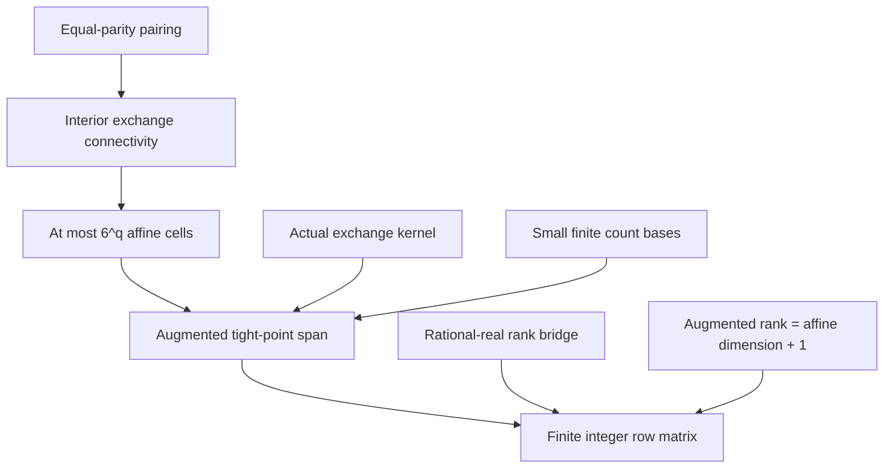

# MOR34 proof roadmap

The exact successful commit and compiler run are recorded in ACCEPTANCE.json. Every result here concerns the original frozen model.

The endpoint is `small_retained_matrix`: for each well-formed model with a nonempty tight set, there exists a selection of finite cell generators producing an integer matrix with at most n+(q+1)6^q rows. Its rational rank is the real affine dimension of the tight set plus one. The columns are the n item coordinates and one augmentation coordinate. Here n is the number of items, q is the number of distinct candidate coefficients including a possible zero class, and a tight point is a feasible binary point satisfying the candidate equality. The structural statement does not assume that the candidate inequality is valid.

The main mathematical assumptions are well-formed grouped knapsack data and nonemptiness of the tight set. Actual exchange graphs, coordinate extrema, affine maps, finite generating sets and the rank equality are proved or constructed. No project axiom supplies these conclusions.

This endpoint is a structural existence theorem and rank certificate. The remaining algorithm stage must show how the prescribed oracle procedure obtains its inputs and outputs, including invalid and empty-face cases. Its running-time theorem additionally needs the fixed-dimensional integer-programming and compression foundations.

See REVIEW_CELLS_20261017.md for edge cases and exact statement correspondence. See NEXT_ALGORITHM_20261017.md for the unresolved implementation and complexity obligations.
